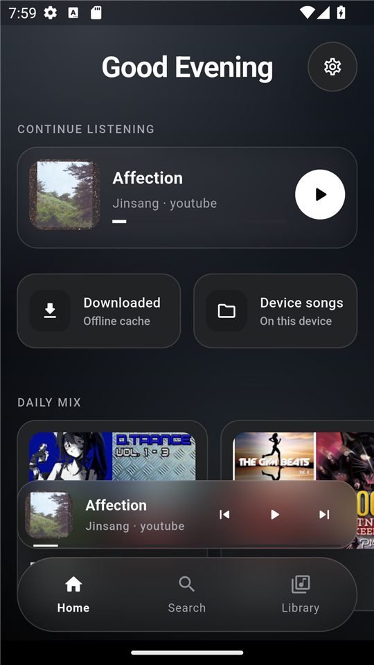
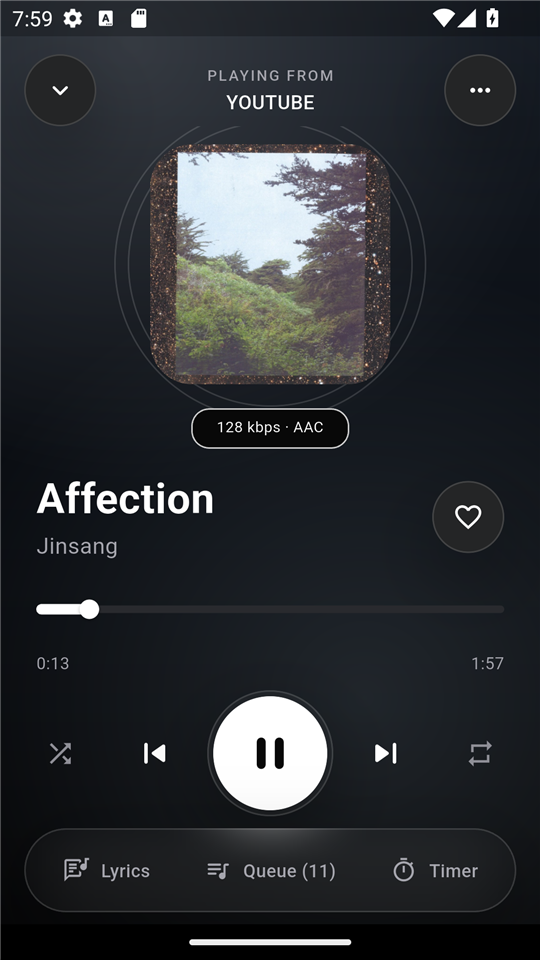
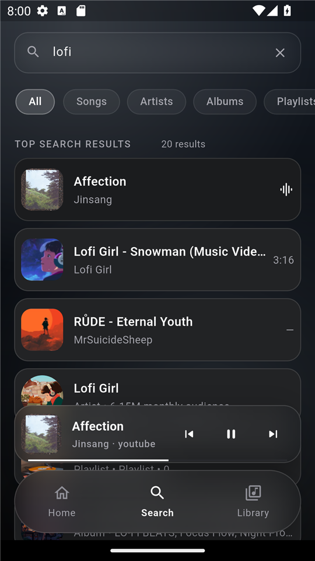

# Voidz Music

[](https://github.com/nazrulfajar/Voidz-Music/actions/workflows/ci.yml)
[](https://github.com/nazrulfajar/Voidz-Music/releases/latest)
[](LICENSE)
[](#download)

**A private, ad-free music player for Android.** Search and stream YouTube Music
on-device, cache tracks for offline listening, keep playback running in the
background, and follow synced lyrics — without an account, ads, or a developer
backend.

> Voidz Music is an unofficial client and is not affiliated with, endorsed by,
> or sponsored by YouTube or Google. Please read the [disclaimer](#disclaimer).

## Contents

[Download](#download) · [Screenshots](#screenshots) · [Features](#features) ·
[How it works](#how-it-works) · [Privacy](#privacy) ·
[Known limitations](#known-limitations) · [Build from source](#build-from-source) ·
[License](#license)

## Download

**[Download the latest APK →](https://github.com/nazrulfajar/Voidz-Music/releases/latest)**

The app is distributed directly through GitHub Releases. There is no Play Store
version.

| Device | Asset |
|---|---|
| Most Android phones and tablets | `VoidzMusic-<version>-arm64-v8a.apk` |
| Older 32-bit devices | `VoidzMusic-<version>-armeabi-v7a.apk` |
| x86_64 emulators | `VoidzMusic-<version>-x86_64.apk` |

**Requirements:** Android 8.0 (API 26) or newer.

**Install:**

1. Download the arm64 APK (recommended for almost all phones).
2. Open it and allow "Install unknown apps" for your browser or file manager
   when prompted.
3. Play Protect may warn because the app is not distributed through the Play
   Store. That is expected; continue only if you trust the source.

Every release includes `SHA256SUMS.txt` so you can verify the APK.

## Screenshots

| Home | Player | Search |
|:---:|:---:|:---:|
|  |  |  |

## Features

- **On-device YouTube Music search and playback** — metadata comes from
  InnerTube and audio is resolved inside the app. No yt-dlp or Python backend.
- **Offline cache** — automatically caches tracks while you listen, validates
  file integrity, supports Wi-Fi-only downloads, and enforces a configurable
  cache limit (1 GB by default).
- **Background playback** — keeps playing with lockscreen and notification
  controls through `just_audio` + `audio_service`.
- **Synced lyrics** — time-synced lyrics from LRCLIB with tap-to-seek and
  auto-scroll.
- **Library and playlists** — liked songs, recently played, downloaded tracks,
  custom playlists, drag-and-drop ordering, and mosaic covers.
- **Queue and discovery** — autoplay suggestions, shuffle, repeat, sleep timer,
  and resume-on-startup.
- **Polished glass UI** — dark/light themes, dynamic artwork backgrounds, and
  responsive phone/tablet layouts.

## How it works

Voidz Music is a Flutter app with **no backend**. It talks directly to public
YouTube Music/YouTube and LRCLIB endpoints. The YouTube stream is resolved
on-device and routed through a loopback HTTP proxy (`127.0.0.1`) so playback can
send the required range/header requests. The proxy is bound to loopback only and
is not exposed to your local network.

State is managed with Riverpod, data is stored locally with Isar, and playback
uses `just_audio` with background media controls.

## Privacy

- **No account, no ads, no analytics, and no crash-reporting SDK.**
- Library, playlists, playback history, search history, and cache stay on the
  device.
- Network requests go directly to YouTube/LRCLIB. No developer backend receives
  your data.
- Android app-data backup and device-to-device transfer are disabled, so the
  local database and cache are not uploaded to Google Drive.
- The app is single-user. There are no profiles or PIN protection; anyone who
  can unlock the device can open the library.

## Known limitations

- **Android only for now.** The iOS scaffold exists, but it has not been
  built or tested on macOS and there is no iOS release.
- **Unofficial YouTube resolver.** It can stop working when YouTube changes its
  endpoints. There is no guarantee of availability.
- **Local data only.** There is no account sync, import/export, or multi-device
  library.
- **No automatic updates.** Download new APKs from GitHub Releases manually.
- **Device song scanning is Android-only.** On iOS, only streaming and cache
  would be available.
- **No Play Store listing.** Installation requires allowing unknown apps.

## Disclaimer

Voidz Music is an unofficial client and is not affiliated with, endorsed by, or
sponsored by YouTube or Google. It accesses public endpoints, does not host or
distribute copyrighted content, and does not provide a public streaming service.
Availability can break at any time when those services change. Users are
responsible for complying with applicable terms of service and local law. The
software is provided "as is", without warranty of any kind.

## Build from source

### Requirements

| Tool | Version |
|---|---|
| Flutter | 3.47.0 (baseline) |
| Dart | 3.13.0 |
| Java | 17 or newer |
| Android SDK | compileSdk 36, minSdk 26 |
| iOS (experimental) | macOS + Xcode 15+ + CocoaPods 1.13+ |

### Run on Android

```bash
cd my_music_player
flutter pub get
flutter run
```

### Run on iOS

iOS builds require macOS and Xcode. The iOS scaffold is present but has not
been verified for release.

```bash
cd my_music_player
flutter pub get
cd ios && pod install && cd ..
flutter run
```

No backend URL configuration is needed. The resolver runs on the device.

### Release APK

```bash
cd my_music_player
flutter clean
flutter pub get
flutter build apk --release --split-per-abi
```

Release builds are signed with a local keystore. The keystore and
`key.properties` are ignored by git and must never be committed. The build
fails if no valid signing configuration is found, so an accidental debug-signed
release cannot be published.

<details>
<summary>Release signing and CI details (maintainers)</summary>

<br>

Point Gradle at the signing properties file in one of these ways:

1. Add this to your user-level `~/.gradle/gradle.properties`:
   ```properties
   voidz.keystore.properties=D:/secure/Voidz-Music/key.properties
   ```
2. Set the `VOIDZ_KEYSTORE_PROPERTIES` environment variable to the same path.
3. Place `key.properties` at `my_music_player/android/key.properties`.

Example `key.properties`:

```properties
keyAlias=upload
storeFile=upload-keystore.jks
storePassword=...
keyPassword=...
```

`storeFile` may be absolute or relative to the properties file.

CI runs `.github/workflows/ci.yml` for pull requests and pushes to `main`
(analyze, tests, debug APK). Pushing a tag such as `v0.1.1` runs
`.github/workflows/release.yml`, which rebuilds, tests, signs the split APKs
with the repository secrets `ANDROID_KEYSTORE_BASE64` and
`ANDROID_KEYSTORE_PROPERTIES`, verifies the signer, and creates the GitHub
Release with `SHA256SUMS.txt`.

</details>

## Project structure

```text
my_music_player/
├── lib/
│   ├── core/        # network, audio, theme, router, errors
│   ├── features/    # player, library, search, browse, lyrics, cache, recap, settings
│   └── shared/      # reusable widgets and providers
├── android/
├── ios/             # experimental scaffold, not released
├── test/            # unit and widget tests
└── pubspec.yaml
```

## Contributing

Issues and pull requests are welcome. When reporting a bug, include the app
version, Android version, device model, steps to reproduce, and relevant logs.
Please do not paste cookies, tokens, keystore files, or personal data into a
public issue.

This is a personal project, so response times may vary.

## License

Source code is licensed under the [MIT License](LICENSE). Third-party
dependencies keep their own licenses; their notices are available in
**Settings → About → Licenses** inside the app.

## Acknowledgements

Built with [Flutter](https://flutter.dev), [Riverpod](https://riverpod.dev),
[Isar](https://isar.dev), [`just_audio`](https://pub.dev/packages/just_audio),
[`audio_service`](https://pub.dev/packages/audio_service), and
[`youtube_explode_dart`](https://pub.dev/packages/youtube_explode_dart).
Lyrics are provided by [LRCLIB](https://lrclib.net).
